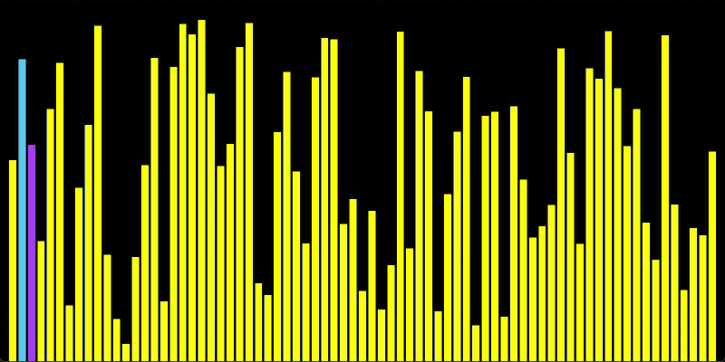

# Insertion Sort Visualizer

A small C++20 + SFML 3 program that sorts 75 bars of random height with
insertion sort, one step at a time, so you can watch the algorithm work.
Every run starts from a new random array.



<sub>Recorded: the first 8 s at real speed (one step every 0.1 s), then the rest at 12×.</sub>

It's a learning exercise, not an app: one window and one key.

| Key   | What it does                         |
| ----- | ------------------------------------ |
| Space | start the sort / pause / resume      |

It opens paused on the random array, and stops stepping on its own once the
array is sorted (the window keeps drawing).

## What you're looking at

- **Yellow**: the bars.
- **Purple**: the position the current key was taken from.
- **Blue**: the bar the key is being compared with.

Each step is 0.1 s. A step is one of three things: pick the next key, shift
one bar to the right, or drop the key into place.

## How it works

### Random data, every run

The heights aren't hard-coded. Each run draws 75 new values between a
minimum bar height and the window height minus the top margin:

```cpp
std::random_device rd;
std::mt19937 gen(rd());
std::uniform_real_distribution<float> height_dist(MIN_BAR_HEIGHT, MAX_BAR_HEIGHT);

for (std::size_t i = 0; i < BAR_COUNT; ++i)
    heights.push_back(height_dist(gen));
```

### One step per tick, not one loop

A normal insertion sort finishes in a single loop, which means it would be
done before the first frame is drawn. Here the loop is turned into a small
state machine (`inserting`, `key`, `j`, `m`) that keeps its state between
frames:

```cpp
if (!inserting) {                       // pick the next key
    key = heights[m];
    j = m - 1;
    inserting = true;
} else if (j >= 0 && heights[j] > key) { // shift one bar right
    heights[j + 1] = heights[j];
    --j;
} else {                                 // drop the key in place
    heights[j + 1] = key;
    ++m;
    inserting = false;
}
```

An `sf::Clock` advances it every `STEP_INTERVAL` seconds, but only while it's
running (Space) and not finished. The window still handles events and redraws
every frame; only the data waits.

### Layout from arithmetic

Bar width, gaps and margins are `constexpr`, derived from the window size and
`BAR_COUNT`:

```cpp
constexpr float USEABLE_WINDOW = WINDOW_WIDTH - 2.f * MARGIN_SIDE;
constexpr float BAR_WIDTH = (USEABLE_WINDOW - (BAR_COUNT - 1) * GAP) / BAR_COUNT;
```

If you change the count, the layout still fits.

## How it got here

1. **Sorting inside the draw loop.** The whole sort ran in one frame, so the
   first thing on screen was already sorted. Sizes were hand-picked numbers,
   and it sorted the shapes themselves, positions included.
2. **Data apart, layout from math, `sf::sleep` to slow it down.** The heights
   moved into their own `std::vector` and the layout became `constexpr` math.
   But sleeping blocks the main thread, so the window stops responding. It
   also wasn't insertion sort yet: an `if` instead of a `while`, with `j`
   reset every pass, so a bar moved at most one place per frame, which is
   closer to a pass of bubble sort. I only noticed when it was pointed out
   to me while learning it with an AI tutor.
3. **A step per tick, on a clock.** This is the state machine above. The
   window stays responsive.

What I took from it:

- An algorithm has to be incremental before it can be animated.
- "Looks sorted" doesn't mean it's the algorithm you meant to write.
- Time-based updates are better than blocking.
- Keep data and drawing apart.
- Derive layout instead of hard-coding it.

## What's next

- **An ImGui control panel** (Dear ImGui) to set the properties live instead
  of recompiling: speed, bar count, a new random array, and more.
- **More algorithms and options**: other sorting algorithms on the same
  step-by-step loop, and options to compare how they move.

## Build

- Windows, Visual Studio 2022, C++20 (`/std:c++20`)
- SFML 3 (graphics, window, system), installed with vcpkg
- Window: 1600 × 800, 75 bars, a step every 0.1 s (all `constexpr` at the top
  of `main.cpp`)

Open `sort-insertion.sln` and run (x64).

## License

MIT. See [LICENSE](LICENSE).
